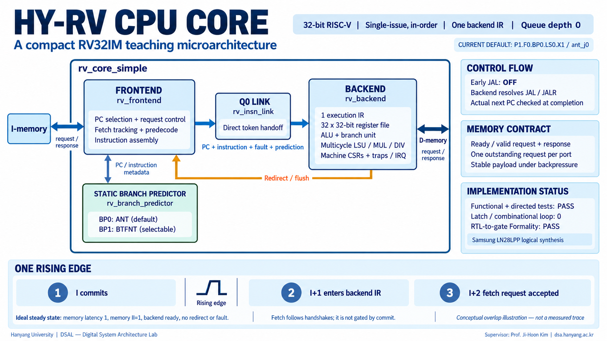

# HY-RV CPU: current microarchitecture

The default lab CPU is **P1.F0.BP0.LS0.X1 / `ant_j0`**, using the local source
snapshot in `rtl/`. The application is freestanding RV32IM/ILP32 in machine mode,
with a 32-bit little-endian datapath, 32 integer registers, and a shared 1 MiB
SRAM in the simulation harness. SRAM is outside the CPU.

The English illustration above was generated for this HY-RV design. It is a
conceptual architecture and ideal overlap illustration, **not a measured trace**.
The original generated PNG is 1672×941, approximately 16:9; it is not a native
4K image. The D-memory label denotes the external D port. See the
[image review](image-review.md), [original prompt](assets/generation-prompt-en-v1.txt),
and [asset provenance](assets/provenance-en-v1.json).

## 1. Start with the whole system

The testbench instantiates the stable `teaching_cpu` compatibility wrapper and a
shared SRAM model. The wrapper instantiates the actual `rv_core_simple` core.
Independent instruction and data channels use ready/valid requests and responses;
they are transaction interfaces, rather than bare SRAM address/data/enable pins.
The memory adapter owns physical memory timing and response holding.

One request per port can be outstanding, with ID zero. Valid and all payload
remain stable while ready is low. Each accepted read or write gets exactly one
response after acceptance. The default `ii1` memory adapter can consume an old
response and accept the replacement request at the same edge. The optional
`frozen` adapter preserves the old bubble-producing timing for comparison.

## 2. Read the four sibling blocks

| Block | Responsibility | Storage / timing |
| --- | --- | --- |
| `rv_frontend` / F0 | Select request PC, track the fetch owner, assemble instruction/fault metadata, ask the predictor | Holds request/owner/control metadata; no instruction response buffer |
| `rv_insn_link` / Q0 | Forward instruction token and ready; gate tokens on flush | Combinational, depth 0; no queue entry or pipeline register |
| `rv_backend` / P1 | Hold one execution IR; decode, RF, ALU, branch, LSU, MUL/DIV, CSR/trap/retirement | One occupied instruction at a time; multicycle operations retain that IR |
| `rv_branch_predictor` / BP0 or BP1 | Form the static predicted successor from PC/instruction metadata | A sibling policy block, not an extra pipeline stage |

Frontend submodules are `gen_pc_nxt`, `fetch_ctrl`, `fetch_tracker`,
`rv_branch_predecode`, and `insn_assemble`. Module boundaries do not imply separate
pipeline stages. The backend checks the actual successor at completion and
redirects/flushes younger work when it differs from the saved prediction.

**BP0 ANT** predicts conditional branches not taken. **BP1 BTFNT** predicts
backward conditional branches taken and forward ones not taken. `EARLY_JAL_EN=0`
in both active presets: JAL/JALR are resolved by the backend. Dynamic BP2–BP4
and a positive-depth instruction queue are future work.

## 3. Understand one rising edge

In ideal steady state, with instruction response latency 1, memory initiation
interval 1, a ready backend, and no redirect/fault, the same rising edge can:

1. Retire instruction I.
2. Admit I+1 into the backend IR.
3. Accept the fetch request for I+2.

This is a conditional throughput example. Fetch generation follows token/owner
capacity and handshakes; it is not gated directly by a commit pulse. An empty
backend can request work without a retirement. During a long-running operation,
the SRAM adapter holds a valid instruction response until admission. F0 does not
copy it into a hidden response buffer. Load/store, multiply, and divide remain
multicycle operations.

## 4. Inspect actual activity

Run `make hw-sim APP=04_muldiv TRACE=1` and open its generated trace report.
The [viewer guide](../viewer/README.md) explains pre-edge samples, request/response
acceptance, IR admission, retirement, and RF writes. Those are separate events.
The [native SVG](../viewer/microarchitecture.svg) maps functional regions to the
current RTL; it is a design diagram whose highlights come from recorded traces.

## 5. Keep source and evidence together

- [Current P1 source identity](../provenance/p1-static-core.json)
- [RTL-to-gate synthesis/Formality evidence](../provenance/p1-rtl-gate-equivalence.json)
- [Current lab validation](current-validation.md)
- [Historical teaching-core validation](validation.md)
- [CPU replacement boundary](core-replacement.md)

Logical synthesis/equivalence and cycle simulation do not establish post-layout
clock frequency or tapeout signoff.
