# 8개 Lab의 정답과 실제 실행 화면

현재 기본 CPU는 HY-RV P1/Q0의 `ant_j0`입니다. 아래 참고 화면과 수치는 최신 P1 코어로 8개 Lab을 다시 실행한 결과입니다.
[실행 기록](reference-results.json)의 소스·preset·메모리 설정과 함께 읽으세요.
기존 teaching-core 결과와 화면은 [과거 실행 기록](historical/teaching-reference-results.json)과
[과거 화면 목록](historical/teaching-screenshots/lab01.png)에 보존했습니다.
[현재 P1 검증](current-validation.md)에서 새 실행의 판정 범위를 확인하세요.

각 실습을 완료했을 때 확인할 결과를 모았습니다. 아래 이미지는 실습 코드를
Spike와 Verilator에서 실행한 뒤 결과 페이지를 브라우저로 연 **실제 화면 캡처**입니다.
실행한 소스와 판정·측정값은 [실행 기록](reference-results.json)에 함께 보관합니다.
사이클 수는 아래 기준 환경의 관측값입니다. 컴파일러나 실행 조건을 바꾼 경우에는
자신의 측정값을 기록하세요.

## 내가 작성한 application도 실행할 수 있나요?

네. Lab 02부터 `student/main.c`를 작성하거나 수정해서 실행합니다.
하나의 ELF를 두 실행기에 넣고 **정답 검사·결과 슬롯·완료 상태·콘솔 출력**을 비교합니다.

```text
나의 C / assembly 코드 → RISC-V GCC → 같은 program.elf
                                      ├─ Spike: ISA 기능 기준 결과
                                      └─ Verilator: 교육용 RTL CPU 실행
                                                 + cycles / 명령어 / RTL trace
```

```sh
make sw-sim SOURCE=student/main.c
make hw-sim SOURCE=student/main.c
make compare SOURCE=student/main.c
```

이 실습의 대상은 저장소에 포함된 **교육용 RV32IM CPU와 작은 C runtime을 사용하는
bare-metal 프로그램**입니다. 정수 연산, 배열, 반복문, 함수, 제한된 `printf`와 정답
검사를 이용할 수 있습니다. 추가 라이브러리와 운영체제 서비스는 해당 실행 환경에
맞게 준비해야 합니다. Spike는 기능의 기준이고, 아래 성능·사이클·파형 관찰은 RTL
시뮬레이션에서 얻습니다. 공개 HTML은 안내와 참고 결과를 보여주며, 각자의 새 실행은
Linux 작업 환경에서 수행합니다.

| Lab | 정답 또는 완료 조건 |
| --- | --- |
| [01](#lab-01) | `sum=22, xor=0x00000014`; 4개 check 일치; smoke 17/17 |
| [02](#lab-02) | 기본 `sum=36`; 마지막 입력 8→10으로 바꾸면 `sum=38` |
| [03](#lab-03) | 처음에는 actual 24 / expected 99로 FAIL; 수정하면 PASS |
| [04](#lab-04) | `sum=36`을 유지하면서 자신의 load·add·branch 실행을 cycle viewer에서 확인 |
| [05](#lab-05) | O0·O2 모두 `sum(1..16)=136`; 각각 ROI·CSR 측정값 기록 |
| [06](#lab-06) | 세 메모리 조건 모두 `sum=36`; 명령어 수를 유지하면서 지연·대기 관찰 |
| [07](#lab-07) | 입력/출력 이미지와 전체 pixel 기준값 일치; grayscale·Sobel 결과 확인 |
| [08](#lab-08) | 자신의 정답 검사와 두 backend 비교 PASS; 기준/변경 실험과 증거 패키지 보존 |

## Lab 01

[환경 확인과 첫 실행](course/01-setup.md). 기본 arithmetic 예제는 두 backend에서
`sum=22, xor=0x00000014`를 출력합니다. check 1~4의 값은 각각 **22, 12, 20, 68**입니다.
모든 Actual/Expected가 일치하고 `COMPARE PASS`가 나와야 합니다.
`make test-smoke`의 완료 조건은 **17/17 expected outcomes**이며, 실패 감지용 세 건이
의도대로 거부되는 것도 포함합니다.

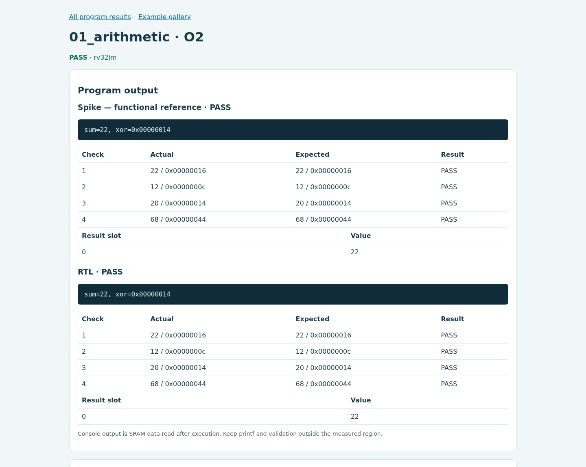

## Lab 02

[나의 첫 main()](course/02-first-main.md). 입력 `{1,2,3,4,5,6,7,8}`의 합은 **36**입니다.
콘솔 `sum=36`, check 201 PASS, result slot 0 = 36을 확인합니다.
마지막 입력을 10으로 바꾸고 예상값도 38로 고치면 `sum=38`이 나옵니다.

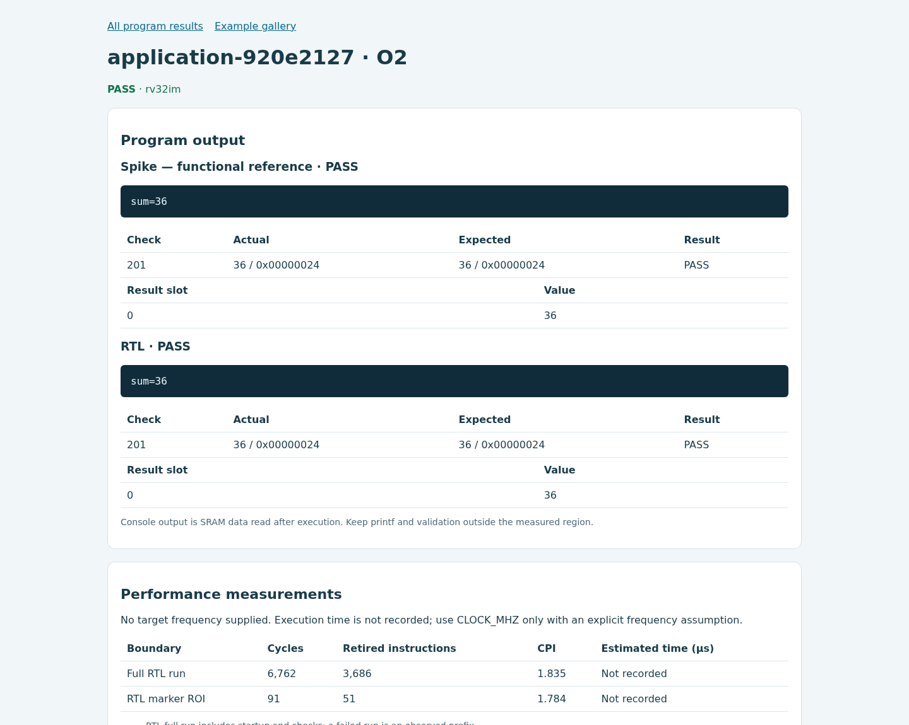

[입력 변경 후 실제 sum=38 화면](screenshots/lab02-sum38.png).

## Lab 03

[틀린 결과를 찾아 고치기](course/03-debugging.md). 최초 코드는 최댓값 **24**를
올바르게 구하지만 기대값을 99로 잘못 적었기 때문에 **두 backend 모두 FAIL**입니다.
아래의 빨간 판정이 이 단계에서 예상한 결과입니다. 비교 결과가 일치하더라도
틀린 정답 검사는 PASS가 되지 않습니다.

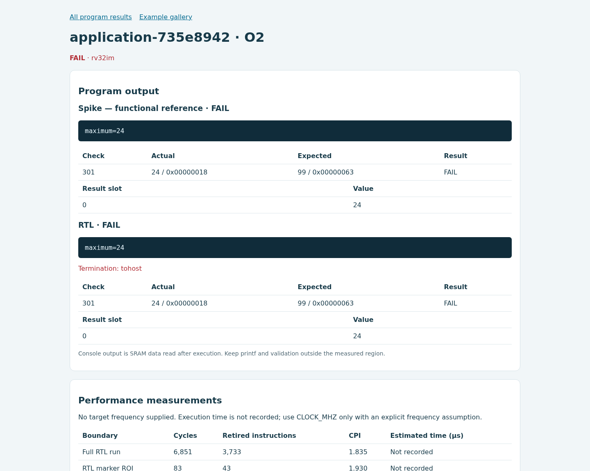

기대값을 24로 수정하면 PASS입니다. 다음 단계에서 마지막 입력을 30으로 바꾸면
정답은 30이며, 반복문에서 마지막 원소를 제외하는 오류를 넣으면 actual 24 /
expected 30으로 실패해야 합니다. 원래 반복문으로 복구하면 30으로 통과합니다.

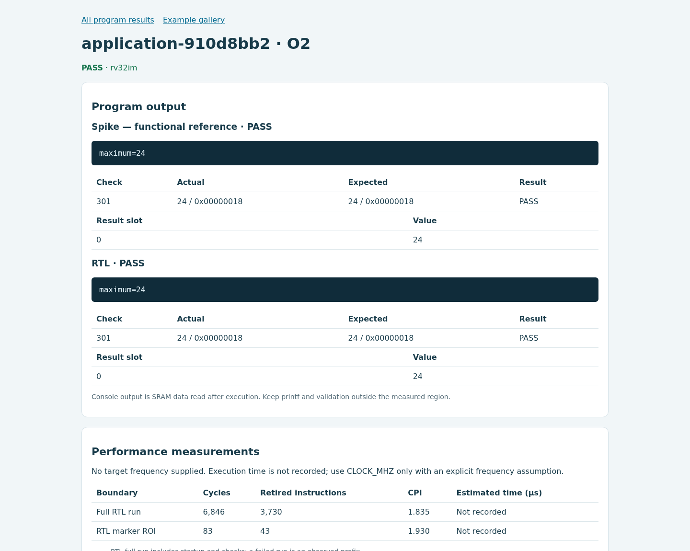

## Lab 04

[명령어와 CPU 실행 관찰](course/04-cycle-viewer.md). Lab 02의 합계 **36**과 PASS를
그대로 유지하면서 프로그램을 등록합니다. 화면에서 자신의 `sum_values` 함수의
명령어·PC·load 요청·실행 상태·retirement를 관찰합니다. 선택한 사이클은 참고 장면이며,
모든 학생이 같은 PC나 같은 사이클을 선택할 필요는 없습니다.

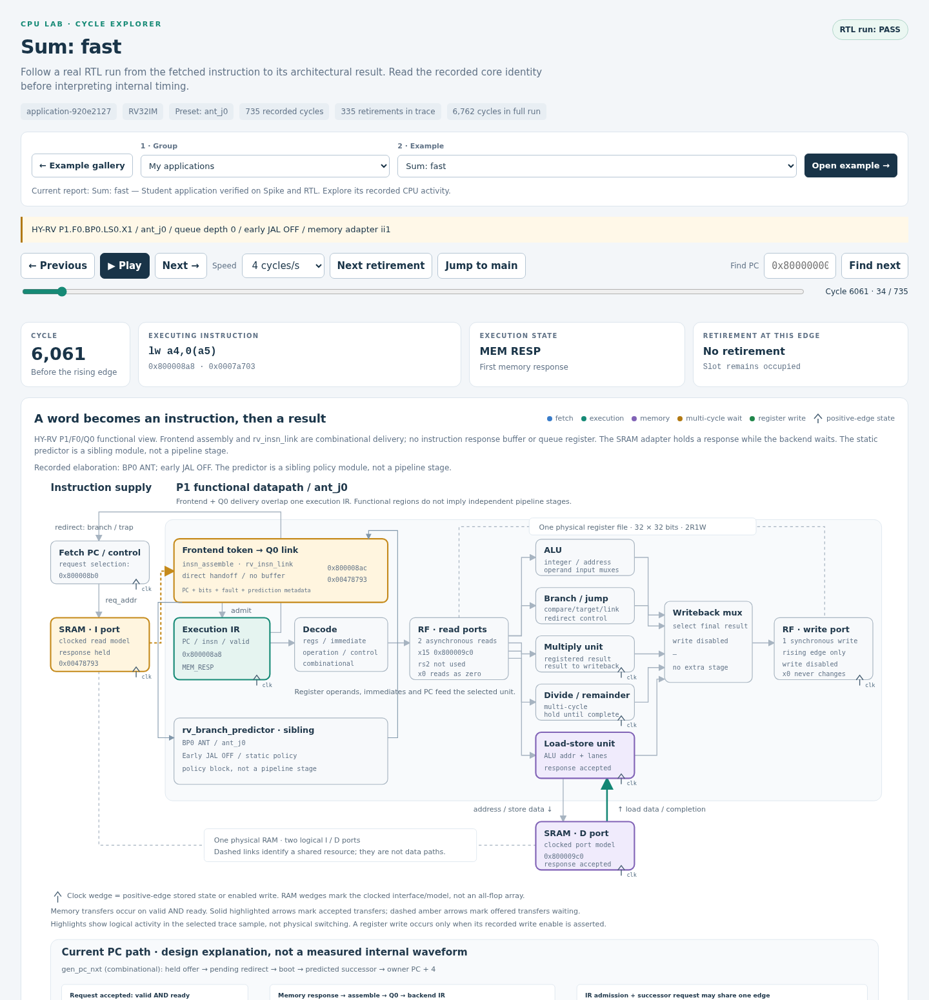

## Lab 05

[성능 개선을 측정하기](course/05-performance.md). 수업 starter는 **1부터 16까지의
합 136**을 계산합니다. O0·O2의 check 501과 전체 기능 결과가 모두 통과해야 합니다.
`lab_perf_begin/end`의 CSR 구간과 `lab_roi_begin/end`의 RTL marker ROI는 경계가
다르므로 측정값을 별도 열에 기록합니다.

| 설정 | 정답 | ROI cycles | ROI retired | ROI CPI | CSR cycles / retired |
| --- | --- | ---: | ---: | ---: | ---: |
| O0 | 136 · PASS | 626 | 262 | 2.389 | 958 / 436 |
| O2 | 136 · PASS | 155 | 83 | 1.867 | 208 / 112 |


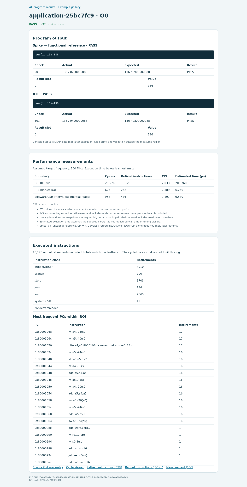

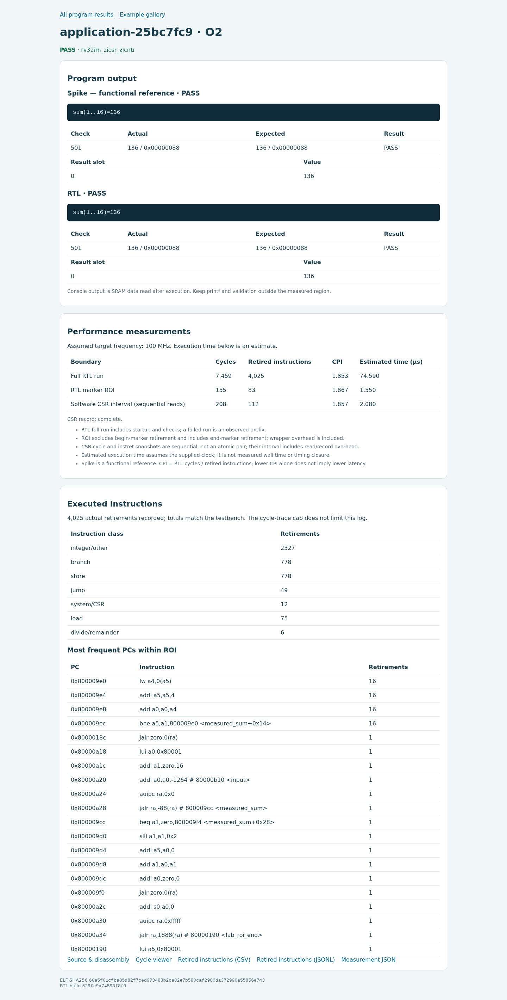

화면의 100 MHz는 시간 환산용 가정입니다. 이 실습에서 관측한 것은 RTL cycles와
retired instructions이며, 실제 칩 주파수나 물리 구현 성능을 검증한 값은 아닙니다.

## Lab 06

[메모리가 느려지면?](course/06-memory.md). 원래 합계 프로그램과 O2 설정을 유지하고
`fast`, `latency3`, `stress`(seed 11)만 바꿉니다. 세 조건에서 정답 **36**, 전체 기능
signature와 ROI 명령어 수를 확인한 뒤 cycles를 비교합니다.

| 메모리 | 정답 | ROI cycles | ROI retired | ROI CPI |
| --- | --- | ---: | ---: | ---: |
| fast | 36 · PASS | 91 | 51 | 1.784 |
| latency3 | 36 · PASS | 204 | 51 | 4.000 |
| stress · seed 11 | 36 · PASS | 328 | 51 | 6.431 |


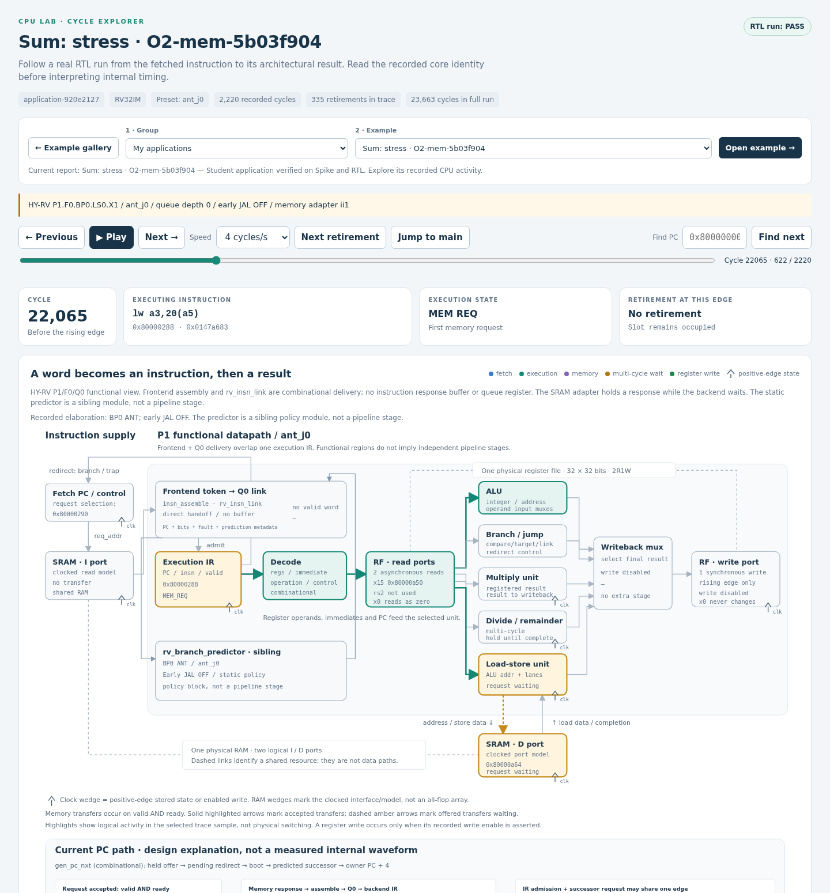

새 참고 화면은 cycle 22065에서 **data request가 ready를 기다리는 시점**입니다.
이는 ROI 이후 runtime 실행 구간이며, 위 ROI 측정값과 구분합니다. 다른 사이클에서는
instruction response가 backend를 기다리는 backpressure도 관찰할 수 있습니다.
메모리 지연은 데이터 load뿐 아니라 명령어 공급에도 영향을 줍니다.

소문자 q/r는 ready를 기다리는 offered transfer, 대문자 Q/R는 수락된 transfer입니다.
요청을 내는 시점, 수락되는 시점과 응답 시점을 나누어 관찰하세요.

## Lab 07

[눈에 보이는 이미지 처리](course/07-images.md). 필수 첫 입력은 **7×5**이고 다음 실험은
**16×12**입니다. `copy`, `grayscale`, `Sobel`, `pipeline`의 실제 출력 전체를 기준값과
비교합니다. 화면의 컬러 입력과 회색 출력은 해당 프로그램이 dump한 buffer입니다.

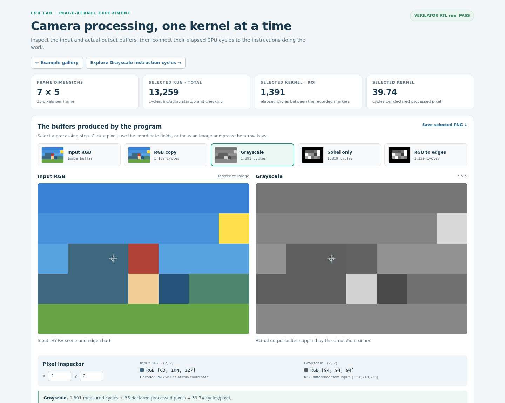

한 픽셀의 정답은 `(77*R + 150*G + 29*B + 128) >> 8`로 계산합니다.

위 화면의 좌표 **(2, 2)**에서는 입력 RGB가 **(63, 104, 127)**이며, 식으로 계산한 값은 **94**입니다. 실제 출력 RGB도 **(94, 94, 94)**입니다.

[16×12 실제 영상 처리 화면](screenshots/lab07-16x12.png).
선택 실습의 denoise·cartoon·ball은 64×48로 별도 실행했습니다. ball의 FRAME=24는
장면 번호입니다.

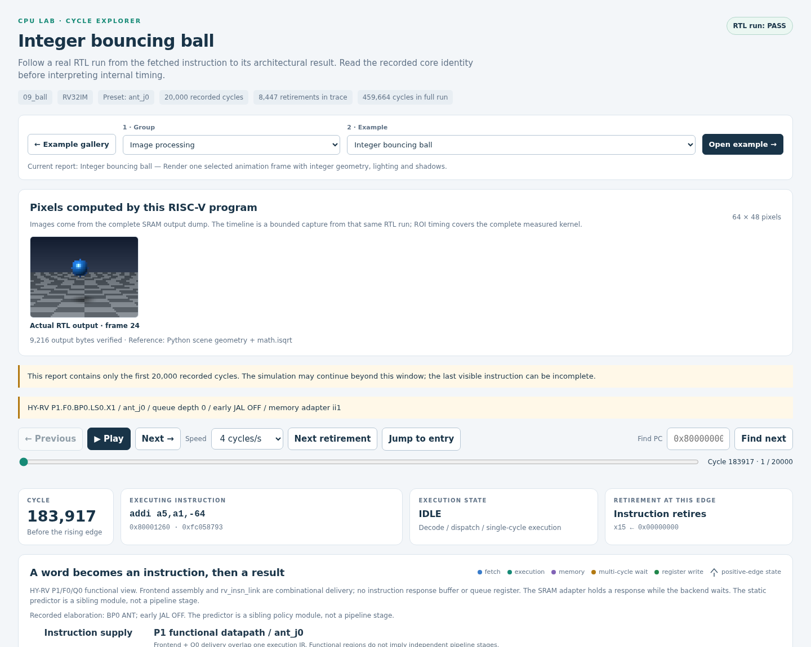

## Lab 08

[재현 가능한 나의 프로젝트](course/08-project.md). 이 Lab에는 모두에게 동일한
숫자나 필수 속도향상 비율이 없습니다. 자신이 정한 입력과 정답 검사를 통과하고,
한 가지 변경의 효과를 근거로 설명하면 됩니다. 아래 참고 실험은 같은 합계 소스·입력·
메모리 조건에서 **컴파일 옵션만 O0→O2**로 바꿨습니다. 두 결과의 정답은 모두 36입니다.

| 버전 | 바꾼 조건 | 정답 | ROI cycles | ROI retired | ROI CPI |
| --- | --- | --- | ---: | ---: | ---: |
| 기준 | O0 | 36 · PASS | 354 | 150 | 2.360 |
| 변경 | O2 | 36 · PASS | 91 | 51 | 1.784 |

이 참고 실험의 cycle speedup은 **3.89×**입니다. 알고리즘은 바꾸지 않았으며 이 수치는 학생 프로젝트의 필수 목표가 아닙니다.


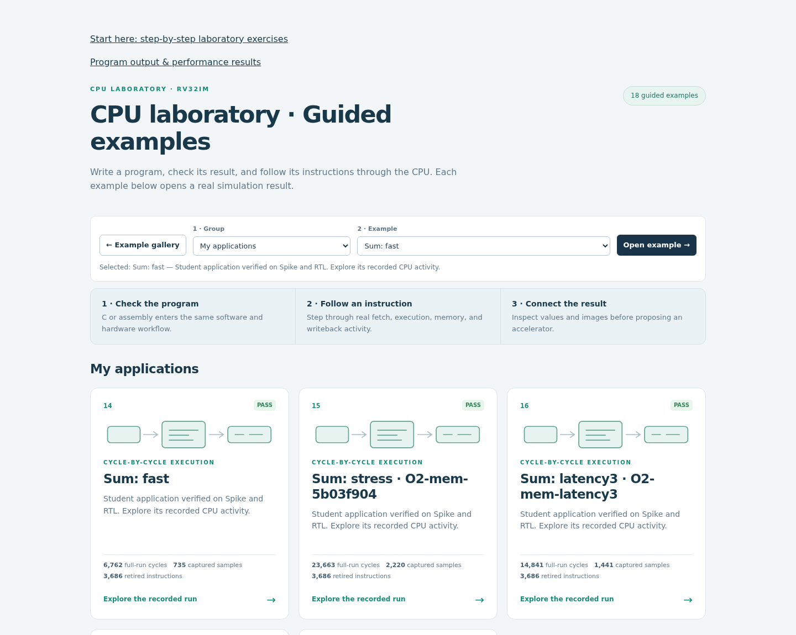

각 버전의 source, ELF hash, `build.json`, `result.json`, `performance.json`,
명령어 기록과 trace를 함께 보관합니다. `make export-views`로 만든
`cpu_lab_examples.zip`을 실제로 풀어 참고 화면의 offline gallery를 확인했습니다.
이 ZIP은 viewer 공유용이므로 제출할 소스와 입력은 별도로 포함해야 합니다.

## 측정 환경과 재현

기준은 `ant_j0` / `EARLY_JAL_EN=0` / Q0 / `ii1` adapter입니다.
실제 소스 SHA-256은 다음과 같습니다.

`35558e91c602324ddf5b2ab8de893bc0baead18cc9a82c3c336e16c6b3213dd8`

[현재 실행 기록](reference-results.json)에 각 단계의 실제 ELF, 판정, 명령과
ROI/CSR/retirement 값이 들어 있습니다. [화면 캡처 provenance](screenshots/provenance.json)는
각 PNG를 실제 HTML·result/ELF/trace hash와 연결합니다. 화면을 위해 과거 teaching-core
PNG를 재사용하거나 수치를 그려 넣지 않았습니다. 의도된 실패는 정상 PASS와 구분합니다.

공개 실습 검증은 [현재 검증 기록](current-validation.md)을 참고하세요. 실제 실행 도구는
Python 3.11.13, RISC-V GCC 15.2.0, Spike 1.1.1-dev, Verilator 5.028이며,
정확한 도구·설정 hash는 실행 기록에 보존했습니다. 현재 source와 preset으로 실제 합성과
Formality도 다시 수행했으며 [별도 증빙](../provenance/p1-rtl-gate-equivalence.json)에
latch/loop 검사, netlist/SVF, 도구와 라이브러리 identity를 보관합니다.
이는 배치·배선 후 timing 또는 tapeout signoff를 뜻하지 않습니다.

[전체 실습 순서로 돌아가기](course/index.md).
